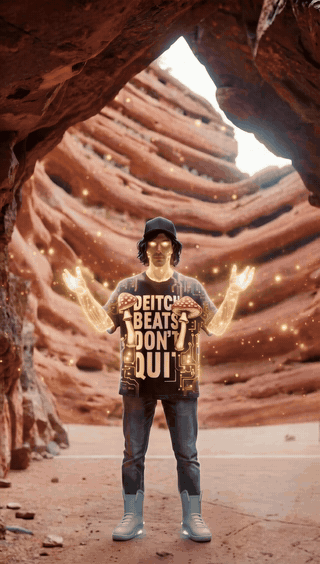
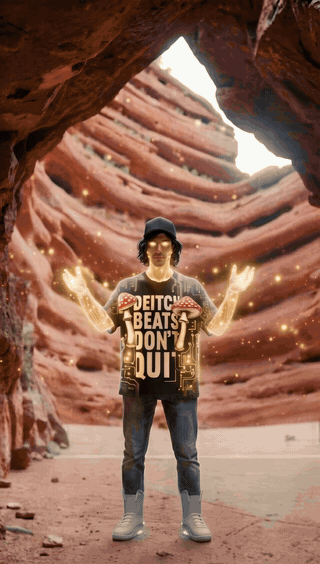
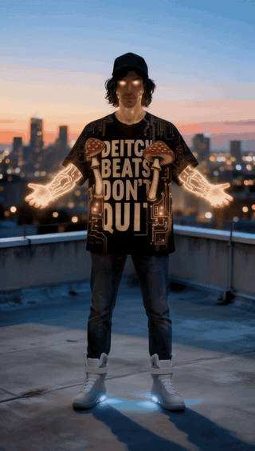
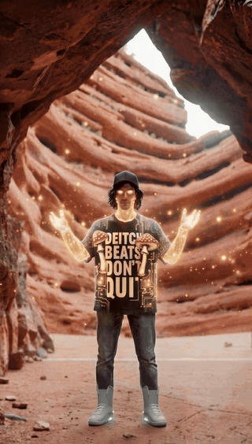
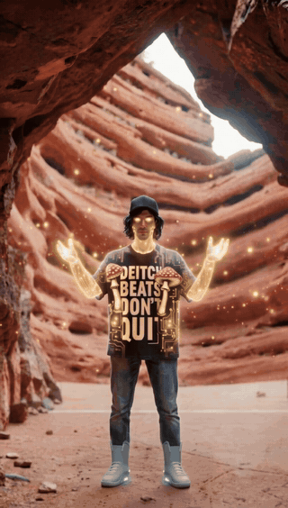
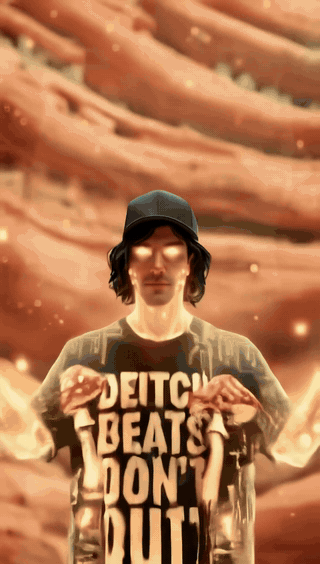
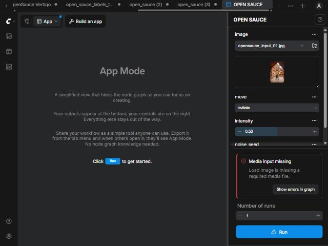

<h1></h1>

**One photo in. A cinematic move out. The recipe rides inside the video.**

Cinematic camera moves and effects, rebuilt as free, open, forkable ComfyUI presets. Every output video carries its own recipe.

OPEN SAUCE is an independent, open-source rebuild of Higgsfield-style camera moves and effects on the Comfy Developer Platform. It is not affiliated with Higgsfield, whose own help center describes its platform and models as proprietary ([source](https://higgsfield.ai/creator-hub/help-center/getting-started/official-higgsfield-platforms)). Built for Comfy's Open Source Higgsfield challenge ([rules](https://comfy.org/open-source-higgsfield), submissions close Oct 30, 2026).


## The menu

Six presets, one pipeline. Each loop below is cut from the locked golden render of that preset.

<table>
<tr>
<td width="33%" valign="top">


The subject stays locked while the world rushes toward you.<br>
<sub><code>shipped</code></sub>
</td>
<td width="33%" valign="top">


A violent push from the wide frame onto the face, a hard stop, then stillness.<br>
<sub><code>shipped</code></sub>
</td>
<td width="33%" valign="top">


The subject chars from the hands inward and crumbles into ash and embers that blow away; the world stays exactly as it was.<br>
<sub><code>shipped</code></sub>
</td>
</tr>
<tr>
<td width="33%" valign="top">


Dust pours over the subject and he sets into a weathered grey stone statue; the world around him stays exactly as it was.<br>
<sub><code>shipped</code></sub>
</td>
<td width="33%" valign="top">


The subject rises; hair and clothes know it.<br>
<sub><code>shipped</code></sub>
</td>
<td width="33%" valign="top">


One photo becomes a one-take trailer with generated transitions and a title card.<br>
<sub><code>shipped</code></sub>
</td>
</tr>
</table>

`python -m app menu` prints the menu in your terminal.


## How it works



All presets run on one shared **LTX-2.5** image-to-video pipeline (open weights, runs on your own GPU) plus the **ShotGrammar** node pack in `custom_nodes/shotgrammar`.

Every tile renders from one command. Petrify and Disintegrate are two-step chains, a Qwen-Image-Edit stage still and then the LTX video: `python -m app render disintegrate --image photo.jpg` runs both, declared as `run_steps` in `presets/<name>.json`. Disintegrate's stage is a clean plate of the scene without the subject; the `SGDisintegrate` node then builds opaque guide frames (charred body, cracks, flakes on the wind) and pins everything outside the live body to that plate, so the body can never fade into the world.


## The app (ComfyUI App Mode)



Each shipped preset is also a ComfyUI **App Mode** app, the same form-style interface Comfy's own Hub apps use: pick a photo, set one or two controls, press Run, the video appears below. Its Fork This Shot recipe rides inside the file; an optional **QR** toggle also stamps it into the last frames.

**One app, preset dropdown.** In ComfyUI open `workflows/app/open_sauce.app.json` (App Mode): photo, **preset** (`levitate`, `crash_zoom`, `dolly_zoom_out` = Vertigo, `push_in`, `pull_back`), intensity 0-1, seed, optional extra prompt, Run. One graph routes each preset to the prompt-led or the depth-guided path (see `docs/app-mode.md`). Petrify and Disintegrate are two-step chains run with `python -m app render` (App Mode cannot chain two graphs).

```
workflows/app/open_sauce.app.json   THE app: photo · preset dropdown · intensity · seed
workflows/app/levitate.app.json     photo · prompt · seed
workflows/app/crash_zoom.app.json   photo · intensity · seed
workflows/app/vertigo.app.json      photo · intensity · seed
```

The hub app also ships as a ShotGrammar workflow template: in ComfyUI's template browser pick **ShotGrammar → open_sauce**, or open `http://<your-comfy>/?template=open_sauce&source=shotgrammar&mode=linear` to land straight in App Mode. Or copy the files into `<ComfyUI>/user/default/workflows/` (or drag one onto the canvas) and they open straight in App Mode; "Graph" shows the full node graph, "Build an app" edits the exposed controls. Petrify and Disintegrate are two-step chains and run from the CLI below. Details: [docs/app-mode.md](docs/app-mode.md).


## Fork This Shot



Every MP4 OPEN SAUCE renders carries its full recipe, invisibly: in the MP4 metadata, as a sidecar JSON in `recipes/`, and as a recipe-card PNG. If you want a clip to stay forkable after social platforms strip the metadata, switch on the QR (the **QR** toggle in the app, `--qr` on the command line): it stamps a scannable link into the last half second. It is off by default, so nothing appears in your video unless you ask for it.

- **Scan (if the QR is on):** point a phone at the QR in the last half second; it opens `recipes/<id>.json` in this repo (preset, seed, models, inputs, the full API workflow).
- **Restore from the file:** `python -m app fork video.mp4` prints the recipe and writes `video.api.json`, the exact graph. Load that file in ComfyUI (recent frontends accept API-format graphs) or submit it with `scripts/run_workflow.py`.
- If a platform strips the MP4 tags, a clip rendered with `--qr` still resolves its recipe from the QR.


## Quickstart

You need an NVIDIA GPU (developed on an RTX 5090 32 GB), git, and Python 3.12+.

```powershell
# 0. get the repo
git clone https://github.com/lightbrushproject/opensauce
cd opensauce

# 1. install a pinned ComfyUI + node packs next to this repo (add -DryRun to preview; Linux/macOS: scripts/install.sh --models-dir ...)
powershell -ExecutionPolicy Bypass -File scripts\install.ps1 -ModelsDir D:\opensauce-models

# 2. get the models. The installer prints the list. LTX-2.5 is gated: accept the terms at
#    https://huggingface.co/Lightricks/LTX-2.5 first, then run scripts\download_ltx25.py (see MODELS.md)

# 3. start ComfyUI (port 8189), then the proxy (port 8190)
cd ..\comfy-opensauce-install; .\.venv\Scripts\python.exe main.py --listen 127.0.0.1 --port 8189
powershell -File scripts\start_proxy.ps1 -ComfyDir ..\comfy-opensauce-install

# 4. render one photo
pip install comfy-sdk opencv-python imageio-ffmpeg mutagen qrcode pillow
python -m app render levitate --image you.jpg
```

Options: `--seed 11`, `--intensity 0.6`, `--prompt "..."` (replaces the preset prompt), `--fill subject=woman` (fills a slot of the preset prompt), `--out dir`.
Best input: a full-body photo with the feet in frame and some ground below, 9:16.
The output is `outputs/levitate/levitate_<seed>_recipe.mp4`, and the last line is the Fork This Shot recipe id and URL. Add `--qr` to also stamp the QR into the last frames.
The reference clips in `examples/<preset>/expected/` are 1088x1920 / 1920x1088 finals at the locked golden seeds; reproduce them with `python scripts/render_goldens.py` (`--preset`, `--golden N`, `--size draft` for 704x1280). Hashes are in `examples/RENDER-LOG.md`.


## Built on the Comfy Developer Platform

The app drives ComfyUI through the official [Comfy SDK](https://docs.comfy.org/development/api-development/sdks). By default it targets your own ComfyUI through [`comfy-api-proxy`](https://docs.comfy.org/development/api-development/sdks) at `http://127.0.0.1:8190` (`COMFY_BASE_URL`, `COMFY_API_KEY=local`), so it uses your GPU and no credits. Point `COMFY_BASE_URL` at a Comfy API deployment and the same code runs there. The actual call, from `app/opensauce.py`:

```python
client = Comfy()                                   # reads COMFY_BASE_URL / COMFY_API_KEY
wf = client.workflows.from_json(patched_graph)     # API-format workflow with the OS:* nodes filled
asset = client.assets.from_file(image)
for nid in by_title(patched, "OS:image"):
    wf.set_input(nid, "image", asset)
job = client.run(wf, timeout=timeout)              # submit and wait
for nid in by_title(patched, "OS:save"):
    for o in job.get_outputs(nid):
        o.to_file(out / o.filename)                # the MP4
```

`comfy-build.yaml` (created with `comfy build init`, validated offline) describes the environment for a Comfy API Build. It has been built and released: Build `54c6b375-242c-4f54-915b-6079f6a79551`, release `88409131-354c-4a8d-a1c0-69cc7caf1f5e`, target linux/nvidia cu130, artifact status ready (Release 2, 2026-10-17). A GPU deployment is started only when a hosted link is needed. See [docs/platform.md](docs/platform.md) for what it holds, what the SDK path exercised, and what is left. No hosted Router or API nodes are used: everything is open weights.


## Models and licenses

See [MODELS.md](MODELS.md): every model with version, license, source and sha256 where recorded. Core: LTX-2.5 (LTX-2.x Community License, free under USD 10M revenue; weights are gated and not redistributed here), Depth Anything V2 ViT-S (Apache-2.0), and for Petrify Qwen-Image-Edit-2511 (Apache-2.0) and BiRefNet (MIT). Models with non-commercial licenses are deliberately not used. Code is MIT; presets and example assets are MIT/CC0.


## Credit


Lightbrush. Animating with AI since 2021.
